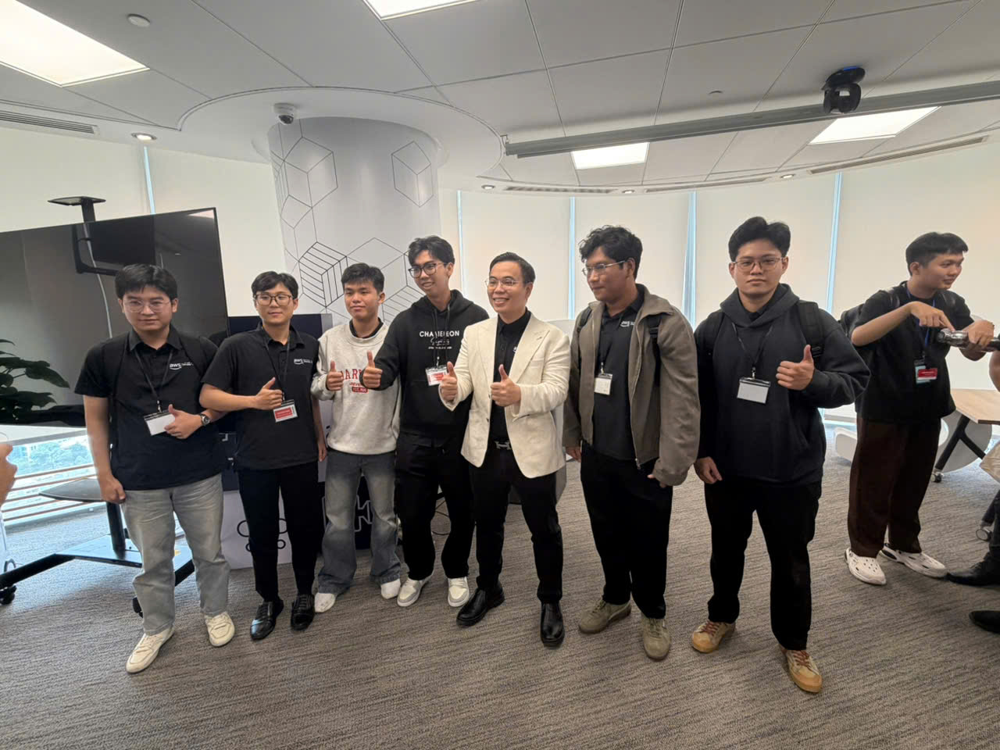

# Buildathon Kickoff: Code the Future with CMC Global

### What I noted

The session introduced the Buildathon format, participation rules and evaluation criteria. The main point I took from Hung Gia's talk was that completing labs is only the first step. For a project, I also need to explain the problem, the design and why a solution was selected.

I was most interested in Truong Bui's example of an internal chatbot at CMC Global. Because the business team in Australia and the engineering team in Vietnam work in different time zones, the chatbot helps collect issue details and pass clearer information to the developers. This showed me a practical use of AI for a specific business problem instead of a general question-and-answer tool.

### What I learned

* Start with the real problem instead of choosing a technology first.
* Understand the data flow and troubleshooting steps, not only whether the application runs.
* Communication and presentation skills are important alongside technical skills.

I later applied this approach to NexusOMS by defining the main business flow before choosing the AWS services.

### Attendance evidence

The attendance application had a technical problem during the event, so I used the participation image accepted by the program.

