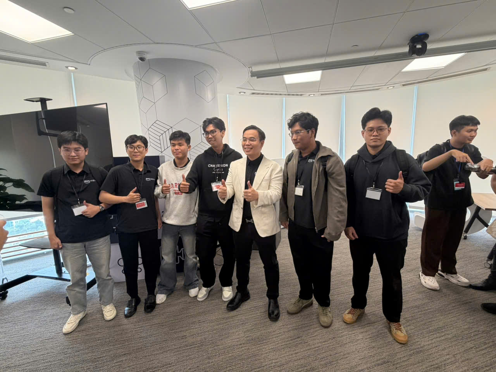

# Buildathon Kickoff: Code the Future with CMC Global

### Nội dung tôi ghi nhận

Đây là buổi giới thiệu chương trình Buildathon, thể lệ tham gia và tiêu chí đánh giá. Phần chia sẻ của anh Hùng Gia giúp tôi hiểu rằng làm lab chỉ là bước đầu. Khi thực hiện dự án, tôi còn phải giải thích được bài toán, cách thiết kế và lý do chọn giải pháp.

Tôi chú ý nhất đến phần chia sẻ của anh Trương Bùi về chatbot nội bộ tại CMC Global. Do đội Business ở Úc và đội kỹ thuật tại Việt Nam lệch múi giờ, chatbot được dùng để tiếp nhận vấn đề, hỏi thêm thông tin và chuyển nội dung rõ ràng hơn cho đội phát triển. Ví dụ này cho tôi thấy AI có thể hỗ trợ một công việc cụ thể trong doanh nghiệp, thay vì chỉ dùng để hỏi đáp chung.

### Điều tôi học được

* Khi làm dự án cần bắt đầu từ vấn đề thực tế, không nên chọn công nghệ trước rồi mới tìm cách áp dụng.
* Ngoài việc chạy được chương trình, tôi cần hiểu luồng dữ liệu, các thành phần liên quan và cách xử lý khi có lỗi.
* Kỹ năng trình bày ý tưởng và trao đổi với người khác cũng quan trọng như kỹ năng kỹ thuật.

Sau sự kiện, tôi áp dụng cách suy nghĩ này khi lên kế hoạch cho NexusOMS: xác định nghiệp vụ chính trước, sau đó mới chọn các dịch vụ AWS phù hợp.

### Minh chứng tham dự

Ứng dụng điểm danh gặp lỗi trong thời gian diễn ra sự kiện, vì vậy tôi sử dụng ảnh tham dự theo hướng dẫn của chương trình.

