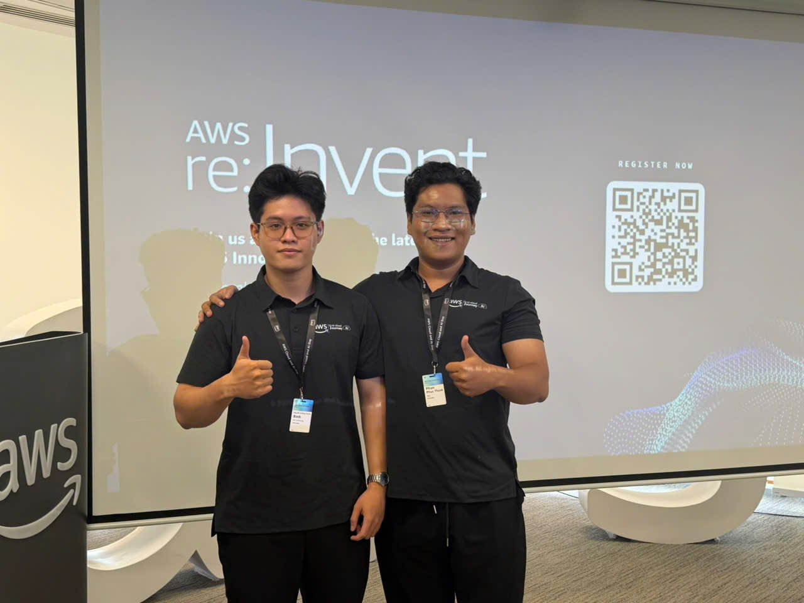

# AWS Cloud Day and AI Day - Ho Chi Minh City Watch Party

### What I noted

I attended the watch party in Ho Chi Minh City and followed sessions about cloud computing, generative AI, data and how companies use AWS. The talks were not only about AI models. They also covered data readiness, security, cost and the work required to operate a system after deployment.

My main notes were:

* AI should solve a specific problem and requires suitable data.
* Access control and sensitive information must be considered before company data is used by an AI system.
* Serverless services can reduce operational work, but cost and service limits still need to be monitored.
* A large architecture is not always necessary. The design should match the actual scale and requirements.
* Business examples helped me understand the difference between a demo and a production system.

### Personal takeaway

After the event, I paid more attention to choosing only the services NexusOMS needed, managing secrets and IAM permissions, and planning resource cleanup. I also learned that a technical report should separate completed work, planned work and estimated cost.

The watch party was also a chance to meet other people learning AWS. This was the second and final event I attended during the program.

### Attendance evidence

