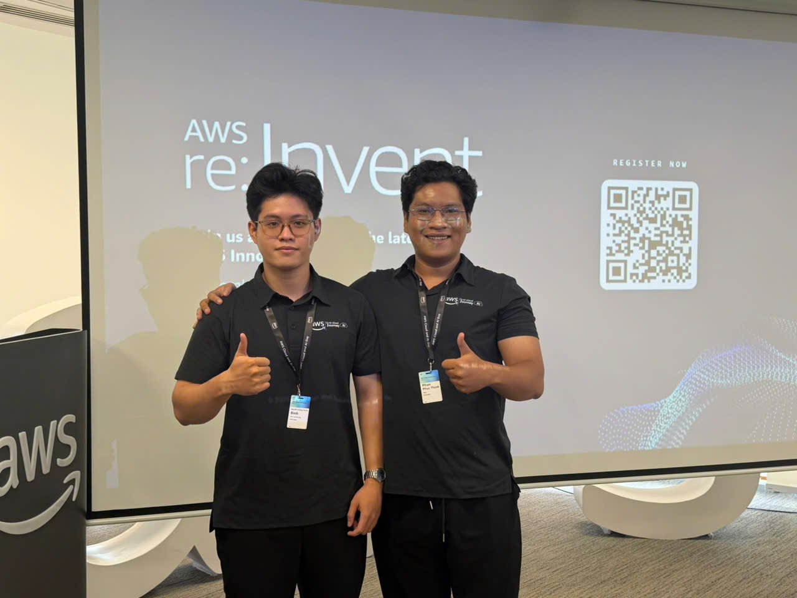

# AWS Cloud Day and AI Day - Watch Party TP. Hồ Chí Minh

### Nội dung tôi ghi nhận

Tôi tham gia buổi watch party tại TP. Hồ Chí Minh và theo dõi các phần chia sẻ về Cloud, Generative AI, dữ liệu và cách doanh nghiệp ứng dụng AWS. Nội dung không chỉ nói về mô hình AI mà còn nhấn mạnh dữ liệu, bảo mật, chi phí và khả năng vận hành sau khi triển khai.

Một số ý tôi ghi lại:

* AI chỉ có ích khi giải quyết được một vấn đề cụ thể và có dữ liệu phù hợp.
* Khi đưa dữ liệu doanh nghiệp vào hệ thống AI cần quan tâm đến quyền truy cập và thông tin nhạy cảm.
* Serverless có thể giúp giảm công việc vận hành, nhưng vẫn phải theo dõi chi phí và giới hạn của dịch vụ.
* Không phải hệ thống nào cũng cần kiến trúc lớn; giải pháp nên phù hợp với quy mô và nhu cầu thực tế.
* Các ví dụ từ doanh nghiệp giúp tôi hiểu rõ hơn sự khác nhau giữa bản demo và hệ thống dùng thật.

### Bài học cá nhân

Sau sự kiện, tôi chú ý hơn đến ba vấn đề khi làm NexusOMS: chọn dịch vụ vừa đủ, quản lý secret/quyền IAM và chuẩn bị bước dọn dẹp tài nguyên. Tôi cũng hiểu rằng một bản thiết kế tốt cần nêu rõ phần đã làm được, phần mới là kế hoạch và chi phí dự kiến.

Buổi watch party còn là dịp để tôi gặp các bạn quan tâm đến AWS và nghe thêm kinh nghiệm học Cloud. Đây là buổi thứ hai và cũng là sự kiện cuối cùng tôi tham gia trong chương trình.

### Minh chứng tham dự

